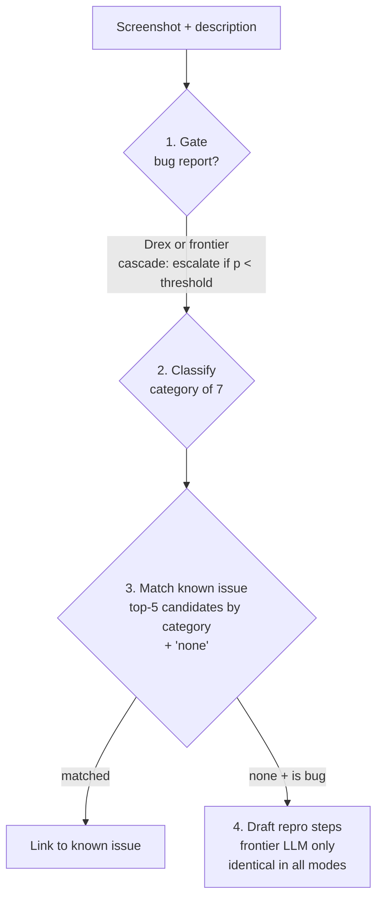

# Drexathon2026_Marisol
A demo-ready hackathon project: a **mock support intake website** where a user
uploads a bug screenshot and a short description. The backend runs a triage
pipeline in which **Drex Max** (a decision model from Nace.AI — image in,
fixed list of options out, one probability per option, no text generation)
makes the classification decisions, while a **frontier LLM** is used only for
escalating low-confidence steps and for drafting reproduction steps for new
bugs.

An evaluation script compares three systems on a labeled screenshot set:
**frontier-only**, **Drex-only**, and a **confidence-gated cascade**. In the
mock-mode evaluation, Drex-only is ~2.9× cheaper and ~5.6× faster than
frontier-only at a 3.6-point accuracy gap (all mock data — see below).

> ⚠️ With `MOCK_MODE=1` (the default for all committed runs) every model call
> is a deterministic local mock. All outputs are labeled "MOCK DATA"; they
> are **not** real measurements and must not be presented as such.

## Pipeline



The repro-draft step (4) runs identically in all three modes and is billed
and timed separately, so it never affects the decision-quality comparison.

## Repository layout

```
demo_app/            FastAPI demo site with 6 seeded bugs (?bug=<flag>)
data/known_issues.json   5 seeded known issues (1 category held out)
data/screenshots/    generated: 56 PNGs + labels.csv
data/results/        evaluation outputs (results.csv, summary.json, 3 charts)
scripts/
  generate_screenshots.py   Playwright: build the labeled screenshot set
  check_dataset.py          sanity-check the dataset
  evaluate.py               run all modes + sweep -> CSV/JSON/charts
app/
  main.py                intake site (FastAPI) + static UI
  pipeline.py            triage(): gate -> classify -> match -> draft
  drex_client.py         the ONLY module that knows Drex's wire format
  frontier_client.py     frontier LLM (openai / anthropic) for escalation + drafts
  store.py               thread-safe, capped (200) in-memory report store
  mocklib.py           deterministic mock primitives
tests/                 pytest: demo bugs, pipeline, intake API
```

## Setup

Python 3.12. With [uv](https://docs.astral.sh/uv/):

```bash
uv venv .venv
uv pip install -r requirements.txt
playwright install chromium        # only needed to (re)generate screenshots

cp .env.example .env               # fill in keys for REAL mode only
```

## How to run

All commands below assume the repo root and the `.venv` from Setup.
**Mock mode** (no keys needed — what was used for all committed results):
prefix commands with `MOCK_MODE=1`.

1. **Demo app with the seeded bugs** (browse to each bug flag):
   ```bash
   MOCK_MODE=1 .venv/bin/python -m uvicorn demo_app.app:app --port 8000
   # http://127.0.0.1:8000/?bug=login_401   (and the other 5 flags)
   ```
2. **Generate the labeled screenshot dataset** (56 PNGs + `labels.csv`):
   ```bash
   MOCK_MODE=1 .venv/bin/python scripts/generate_screenshots.py
   MOCK_MODE=1 .venv/bin/python scripts/check_dataset.py
   ```
3. **Start the intake site** and upload a screenshot from the browser:
   ```bash
   MOCK_MODE=1 .venv/bin/python -m uvicorn app.main:app --port 8000
   # open http://127.0.0.1:8000/, pick a PNG from data/screenshots/,
   # choose a mode, set the cascade threshold, Run triage
   ```
4. **Run the evaluation** (all three modes + threshold sweep + calibration):
   ```bash
   MOCK_MODE=1 .venv/bin/python scripts/evaluate.py
   # writes data/results/{results.csv, summary.json, 3 PNG charts}
   ```
5. **Tests** (22 tests; mock mode is forced by `tests/conftest.py`):
   ```bash
   MOCK_MODE=1 .venv/bin/python -m pytest tests/ -q
   ```

## Mock mode vs. real mode

- **Mock:** set `MOCK_MODE=1`. No API keys are read. Drex and frontier calls
  are replaced by deterministic functions of the image bytes
  (`app/mocklib.py`) with hash-driven noise, so runs are reproducible and the
  charts are non-trivial. The intake UI shows a "MOCK MODE" badge, and every
  chart title / summary.json entry says "MOCK DATA".
- **Real:** unset `MOCK_MODE` (or set it to anything else) and set in `.env`
  (never committed, never sent to the browser):
  - `NACE_API_KEY` — Drex Max key (`nace_sk_…`); `NACE_BASE_URL` and
    `NACE_MODEL` are editable in `app/config.py` (defaults match the hosted
    docs: `https://console.nace.ai`, `drex-max-v1.1`).
  - Second model (escalation/draft step) — **DeepInfra by default**
    (`FRONTIER_PROVIDER=deepinfra`): set `DEEPINFRA_API_KEY` (`di-…` key from
    deepinfra.com). It uses DeepInfra's OpenAI-compatible endpoint
    `https://api.deepinfra.com/v1/openai` with the vision model
    `Qwen/Qwen3-VL-30B-A3B-Instruct` (both overridable via `FRONTIER_MODEL` /
    `FRONTIER_BASE_URL`). To use OpenAI or Anthropic instead, set
    `FRONTIER_PROVIDER=openai|anthropic` plus `FRONTIER_API_KEY` /
    `FRONTIER_MODEL`.
- Cost estimates use the editable per-token price tables in `app/config.py`
  (`DREX_PRICING`, `FRONTIER_PRICING` — labeled estimates, not quotes).

## Observed results (mock mode only)

Run on 2026-11-14 with `MOCK_MODE=1`, 56 labeled images (168 rows in
`data/results/results.csv`). Deterministic mock — **not real measurements**:

| mode | category acc | gate acc | match acc | decision latency mean | cost / 1,000 |
|---|---|---|---|---|---|
| frontier_only | 0.911 | 0.911 | 0.911 | 3287 ms | $8.26 |
| drex_only | 0.875 | 0.821 | 0.875 | 584 ms | $2.88 |
| cascade @ 0.70 | 0.875 | 0.875 | 0.875 | 1600 ms | $4.99 (escalation 39%) |

The cascade sweep (0.50–0.95) trades cost against escalation rate; see
`data/results/accuracy_vs_cost.png`.

## Known limitations

- **In-memory storage only.** `app/store.py` holds at most 200 triage records
  in RAM (oldest dropped first). **All reports are lost when the server
  restarts.** There is deliberately no database, and uploaded image bytes are
  never written to disk. The store is behind a 3-method interface
  (`add`/`get`/`list`) so a database can replace it later.
- **Small, synthetic dataset.** 56 generated screenshots of a toy app
  (8 per category, 3 viewport sizes × themes × zooms, plus 8 `other`).
  Results on 56 images have wide confidence intervals; the evaluation's job
  is to demonstrate the harness, not to make statistical claims.
- **Drex is closed-set.** Drex answers only from a fixed list of options;
  it cannot describe what it sees, so anything outside the option set
  (e.g. a bug type we didn't define) can only be bucketed into `other`.
  The pipeline compensates by escalating to the frontier LLM below a
  confidence threshold and by using the frontier LLM for free-text drafts.
- **Unverified Drex API assumptions** (marked `# ASSUMPTION:` in
  `app/drex_client.py`; the client is the only module that touches the wire
  format, so these are the only places a real integration would need changes):
  1. `app/drex_client.py:118` — `images` string items are base64 data URLs.
     The docs allow `string | object` with a 16 MiB per-image / 4 MiB body
     limit but do not state the string encoding.
  2. `app/drex_client.py:145` — the choice response's `probabilities` keys
     are exactly the `criteria` keys (as in the documented example).
- **Pricing is editable guesswork.** The price tables in `app/config.py` are
  clearly-labeled estimates; Drex billing is per input token, which the
  estimate reflects, but figures are not authoritative.
- **The second-model client is implemented against DeepInfra's
  OpenAI-compatible API (default), OpenAI's chat-completions API and the
  Anthropic Messages API.** The DeepInfra endpoint was live-verified
  (unauthenticated probe) on 2026-11-14, but no real calls have been made
  here; all runs were mock mode.
